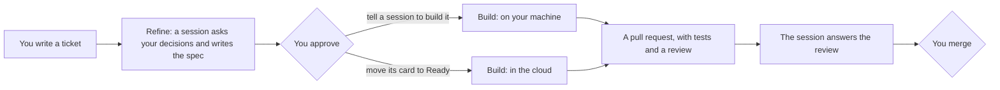

# Software factory

> **Early, and not yet for general use.** This is below 1.0: it changes
> weekly, and any minor version may break what the one before it did,
> without notice. Pin an exact version if you try it.

You already ask an AI assistant to write code. The hard part is everything
around it: saying clearly what you want, checking it built that, getting it
reviewed, fixing what the review finds, and doing it the same careful way
the hundredth time as the first. That part still needs you at the keyboard,
one prompt at a time.

The software factory does that part. You write a ticket. Your coding agent
turns it into a spec, asking you only the decisions that are yours, builds
it with tests, has it reviewed, answers the review, and hands you a pull
request to read. You decide what merges.

## What changes for you

- **You write tickets, not prompts.** A few sentences of what you want and
  why. The factory asks the rest.
- **Every change is built the same way.** A test first, the change, your
  own checks, a review, and a pull request that says how it was verified.
- **You are asked only what is yours to decide,** each question with a
  recommended answer, and nothing merges without you unless you said which
  files may.
- **Work can run while you are away.** Start a build in the cloud with one
  command, or have one start whenever you move a ticket to Ready on your
  board, with no session open on your machine.
- **You can see where everything stands.** A board shows every ticket's
  state, which session has it, and what it cost.

## How a ticket moves

Two steps are yours: approving a ticket, and merging its pull request. A
session of your coding agent does every step in between, on your machine
when you ask it to, or in the cloud when you move a card.
[Workflow](docs/workflow.md) follows a ticket through each step.

## Who it is for

Someone who uses a coding agent on a repository, in any language, and
wants tickets built the same careful way every time: one person with
several repositories, or a small team.

**What it is not.** It is not a hosted service: everything runs in your
repository, your CI, and your agent's account. It does not replace reading
the pull request.

## What it works with

The factory talks to each tool through one interface, so another can be
added without changing the rest. Today each has one choice:

| You need                                              | Supported today                    | Setting it up                                |
| ----------------------------------------------------- | ---------------------------------- | -------------------------------------------- |
| A code host, for the repository and its pull requests | GitHub                             | [Setting up on GitHub](docs/github/setup.md) |
| A ticket system, and optionally a board               | GitHub Issues, and GitHub Projects | [Setting up on GitHub](docs/github/setup.md) |
| Somewhere to build in the cloud, optionally           | GitHub Actions                     | [Setting up on GitHub](docs/github/setup.md) |
| A coding agent                                        | Claude Code                        | [Setting up on GitHub](docs/github/setup.md) |

## Get started

[The quick start](docs/quick-start.md) takes you from nothing to a first
built pull request. Refining and building a ticket on your machine needs
only the package: no board, no secrets, and nothing to host. Everything
else is optional and comes later.

## What it holds to

1. **Your agent writes the code; a person approves it.** A cloud build's
   commits name your coding agent as their author. People approve the
   ticket, review the pull request, and merge it, and whoever merges
   answers for it.
2. **Everything waits for you unless you said otherwise.**
3. **It works with nothing configured.** Every setting has a default.

## The docs

**Start here**

| Page                                         | For                                                            |
| -------------------------------------------- | -------------------------------------------------------------- |
| [Quick start](docs/quick-start.md)           | Your first built ticket, step by step                          |
| [Setting up on GitHub](docs/github/setup.md) | What `factory init` asks on GitHub, and what it leaves for you |
| [Workflow](docs/workflow.md)                 | How a ticket moves, and which steps are yours                  |
| [Glossary](docs/glossary.md)                 | Any word here you do not know                                  |

**Guides**

| Page                                                           | For                                       |
| -------------------------------------------------------------- | ----------------------------------------- |
| [Adopting it in an existing repository](docs/existing-repo.md) | Not JavaScript, an existing board, a team |
| [Plug-ins](docs/plugins.md)                                    | Adding your own reviewers and skills      |
| [Builds in the cloud](docs/builds.md)                          | Starting builds from your board           |
| [Updating](docs/updating.md)                                   | Getting a new version                     |
| [What it changes, and removing it](docs/removing.md)           | Everything it adds, and how to undo it    |

**Reference**

| Page                                                         | For                                                |
| ------------------------------------------------------------ | -------------------------------------------------- |
| [The commands](docs/cli.md)                                  | Every command, by when you use it                  |
| [Skills](docs/skills.md)                                     | What each skill does, and what it never does       |
| [Configuration](docs/configuration.md)                       | The settings most change, then every key           |
| [GitHub and Claude Code reference](docs/github/reference.md) | Where each part lives on GitHub and in Claude Code |
| [Setting up on GitHub by hand](docs/github/by-hand.md)       | Every step `factory init` takes, and every secret  |

**About**

| Page                                    | For                                              |
| --------------------------------------- | ------------------------------------------------ |
| [Why it works this way](docs/design.md) | The reasons behind its choices                   |
| [Limitations](docs/limitations.md)      | What it does not do, and what is untested        |
| [Developing](docs/developing.md)        | Working on the factory itself, and what is built |

Some of what these pages describe is still being built. Each such step is
marked _[Planned](docs/developing.md#what-is-built)_, with what to do until
then.

## License

MIT.
