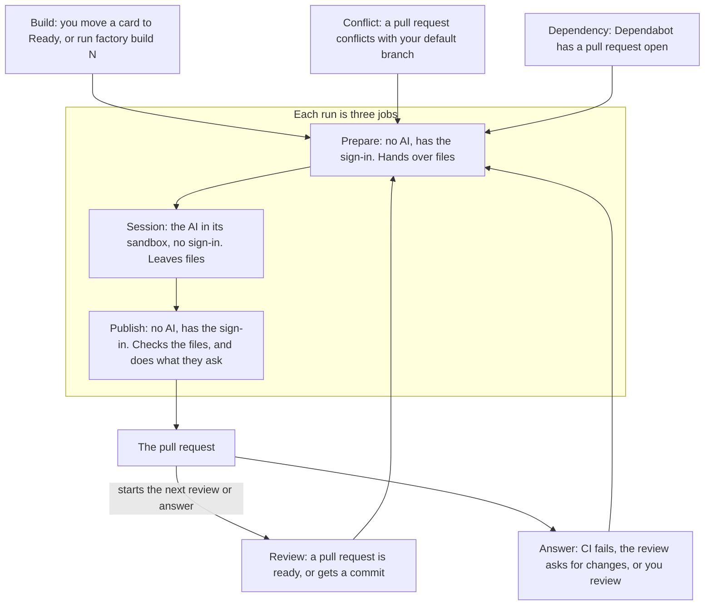

# Builds in the cloud

A build is one session taking one approved ticket to a pull request. You
can always build a ticket by running `/factory-build N` in a session on
your machine. A build in
the cloud does the same with nobody at the keyboard: it runs on your code
host's cloud runner, and you read its log or its pull request afterward.
This page is for someone deciding whether to build in the cloud, or who
wants to know what happens when they do. At the end you know what each run
does, what it costs, and which way of starting one fits you.

On GitHub, the cloud runner is GitHub Actions.
[Setting up on GitHub](github/setup.md) has the steps,
and the [reference](github/reference.md#workflows) has what runs there.

## Three ways a build starts

| What you do                          | Where the build runs                    | What you need                                                     |
| ------------------------------------ | --------------------------------------- | ----------------------------------------------------------------- |
| Run `/factory-build 12` in a session | In that session, wherever you opened it | Nothing                                                           |
| Run `factory build 12`               | In the cloud                            | Builds in the cloud set up                                        |
| Move the ticket to Ready on a board  | In the cloud, at the poller's next pass | Builds in the cloud set up, and [the poller](#the-poller) running |

Which of the last two you use is
[`builds.trigger`](configuration.md#builds) in your
[settings](configuration.md#builds):

| `trigger`       | What moving a ticket to Ready does                                                                                |
| --------------- | ----------------------------------------------------------------------------------------------------------------- |
| `manual`        | Records your approval and starts nothing. The default                                                             |
| `own-server`    | Starts a build within a minute, through the poller you host                                                       |
| `github-action` | Starts one at the next pass of a schedule on the cloud runner, every `poll-minutes` minutes, with nothing to host |

`manual` is a fine place to stay. Running `/factory-build N` in a session
and running `factory build N` work whatever the trigger.

## What a build in the cloud does

```text
$ factory build 12
Started a build of ticket 12 in the cloud:
https://your-code-host/your-name/your-repo/runs/123456789
```

Anyone who can write to the repository can start one. The build's first
act is a comment that takes the ticket, its [claim](glossary.md#the-words),
which names who did. The run's log shows each thing the
session says and each command it runs, as it happens, then the session's
turns and cost. The board shows the ticket In progress, with where it runs
and the run's link.

It ends with a pull request marked ready and a report on the ticket. What
comes after, the review and the answers to it, are runs of their own
([What a cloud run is](#what-a-cloud-run-is)).

**How long it may run.** A build's session may run for 230 minutes, which
[`session-minutes`](configuration.md#session-minutes) changes. A build that
ends without opening a pull request releases its claim in its last job,
so a failed run does not hold its ticket.

**What it needs.** Two credentials, stored as secrets on the code host:
your coding agent's credential, which pays for the session, and an access token for the
code host, which the build acts as. On your own account,
[`factory init`](github/setup.md#run-factory-init) asks for each and
stores it. In an organization, an owner stores the agent's credential once,
with the key of the organization's own app on the code host, and the
jobs that need an access token make one from that key, so `factory init`
asks a developer for no token. The session itself is given no access
token ([Where your tokens are kept](credentials.md#on-github)).

**Who it acts as.** On your own account, the build acts as whoever owns
that access token. Its commits name your coding agent as their author
and that account as their committer, and its pull request and comments
are that account's. When the token is yours, that is you. A team that
wants an agent account makes one on the code host, gives it write
access, and stores its token instead. A session takes instructions from
anyone who can write to the repository, but never from a comment the
factory posted, so an agent account cannot instruct a later session. In an organization that is set
up, the build acts as the organization's app: the pull request and
comments are the app's, and the commits name it as their committer.

**Its commits are never signed,** on your own account or under an
organization's app: no job that runs a session holds a signing key
([Limitations](limitations.md#what-it-does-not-do)).

**Before the session starts,** the commands under
[`commands.build-setup`](configuration.md#commandsbuild-setup) in your
settings run, as your default branch has them. Your npm dependencies are
installed before them, with `npm ci`, when your repository's root has a
`package-lock.json`.

**When there is nothing to build to,** the build claims the ticket and then
stops it with the reason, as any build that stops does. A ticket with no
Spec and no Acceptance criteria gets:

```text
it has no Spec or Acceptance criteria section, so there is nothing to build yet: refine it first
```

**When the ticket names several repositories,** each is built by a run in
its own repository, one at a time. The run that opens a pull request starts
the next: [Build it in the cloud](across-repositories.md#build-it-in-the-cloud).

## What a cloud run is

Five kinds of run use your coding agent. Each is three jobs, each on a
machine of its own, so that the agent and a sign-in to your code host are
never on the same one:



| Job     | What it does                                                                                                                                        |
| ------- | --------------------------------------------------------------------------------------------------------------------------------------------------- |
| Prepare | Decides whether there is anything to do, claims the ticket of a build, and hands over the code, the ticket, and what the session may read, as files |
| Session | Runs the skill on those files, in the coding agent's sandbox. Its commands reach the npm registry, the hosts you list, and nothing else             |
| Publish | Checks the commits and the requests the session left, then pushes, opens the pull request, replies, and comments. It runs nothing the session wrote |

[What each job holds](credentials.md#what-each-job-holds) says which secrets
reach which job, and
[what a hijacked session could still do](credentials.md#what-a-hijacked-session-could-still-do)
says what is left.

| Run        | What starts it                                                                                                                                            | What its session does                                                                        |
| ---------- | --------------------------------------------------------------------------------------------------------------------------------------------------------- | -------------------------------------------------------------------------------------------- |
| Build      | The [poller](#the-poller), or `factory build N`                                                                                                           | Builds a ticket with `factory-build`                                                         |
| Review     | A pull request marked ready, each push to it after, and a change of its base branch, with [`pr-review`](configuration.md#pr-review) set                   | Reads the pull request, and answers with findings and a verdict. Publish posts them          |
| Answer     | CI failing, or the review asking for changes, on a pull request a build in the cloud opened. A review you submit, on any pull request from the repository | Works what is open with `factory-address-review`                                             |
| Conflict   | A push to your default branch, and nightly, once for each pull request that conflicts                                                                     | Merges your default branch into it, with `factory-resolve-conflicts`                         |
| Dependency | Three times a day, once for each pull request Dependabot has open                                                                                         | Moves it toward merged, with `factory-deps`, in a repository with a `.github/dependabot.yml` |

Every run but a review acts as the account a build does. A review posts
as `github-actions`.

**A run remembers nothing.** The ticket, the pull request, and its threads
are its memory. On your machine, a session
waits for CI and the review. In the cloud it ends, and says:

```text
This run ends here. The next one starts when CI and the review have finished.
```

**What a session asks for is done after it ends.** In the cloud, a `factory`
command that would write prints `Asked:` and is kept. Publish runs only a
short list of them, and only on the run's own ticket and pull request:

- Comment on the ticket or the pull request, edit the ticket, and stop or
  end the work on it.
- Open one draft pull request, from a build. It and the commits may
  say they close only the run's own ticket. For a ticket that names several
  repositories, neither may say it closes the ticket, which closes itself
  when the last one merges.
- Reply to and resolve the pull request's review threads, and ask for its
  review again.
- List a [follow-up](workflow.md#follow-ups) in the pull request, its box
  empty, from a build or an answer.
- From a Conflict or a Dependency run, open a ticket.

Anything else, such as a label or a merge, is refused as the session asks for
it, with the reason. A `factory` command that reads something Prepare did not hand over says so:

```text
✗ Ticket 40 was not handed to this run. Go on without it, or stop with: factory ticket stop 12 "needs ticket 40"
```

**After it pushes, Publish waits for CI,** for up to an hour, and says on
the pull request when CI has not finished by then. When CI passes, it marks
a draft ready, which starts the review, unless the session opened it with
`factory pr open --draft` for you to mark ready yourself, or no build in the
cloud opened it. When CI fails, or the review asks
for changes, the next answer starts by itself, if a build in the cloud
opened the pull request. Two reviews that asked for changes are answered
([`rules.review-rounds`](configuration.md#rules)), and a pull request gets at most four answers started this way. Then Publish
says so on it:

```text
This waits for a person: it has had 4 answers. What is still open is in its checks and threads.
```

An answer to a review you submit counts toward neither limit. On a pull
request that no build in the cloud opened, the session that opened it
answers the automated review, or you
[start an answer by hand](github/reference.md#the-jobs).

A session that ends early pushes nothing, and Publish says so on the ticket
or the pull request, with the run's address:

```text
The session did not finish, and nothing of its was pushed. Its run: https://your-code-host/your-name/your-repo/runs/123456789
```

### A change to a workflow file

A session can't change a file under `.github/workflows/`: what is in one
runs with your repository's secrets. Publish pushes nothing then, whatever
else the session did, and comments on the ticket, or on the pull request
for any run but a build:

```text
Not pushed: commit 3c9f730 changes .github/workflows/ci.yml, which a build in the cloud can't push.
Build this ticket on your computer: tell a session to work it. The commits are in the run: https://your-code-host/your-name/your-repo/runs/123456789
```

On your computer that is `/factory-build 12` in a session. The run's page
keeps the commits for seven days, as the artifact whose
name starts with `out-`. Publish also refuses commits that add a symbolic
link or a submodule, merge anything but your default branch, are in another
person's name, or whose message closes another ticket, and a build that asks
for no pull request. Nothing else the session
asked for is done then but a stop.

### What a session can use

- **Hosts.** Its commands reach the npm registry and the hosts you list
  under [`builds.hosts`](configuration.md#builds). Your code host is never
  one, so a package it serves can't be installed by a session
  ([`commands.build-setup`](configuration.md#commandsbuild-setup) says what
  to do instead). A package manager other than npm needs its registry
  there:

  ```yaml
  builds:
    hosts:
      - pypi.org # pip's registry, and where its files are
      - files.pythonhosted.org
  ```

  It worked when your gate passes in a build.

- **Git LFS files are pointers.** There is no sign-in to fetch them with, so
  a gate that reads one fails.
- **Docker does not run there.** A gate or a test that starts a container
  fails, so that ticket is built on your machine.
- **A browser needs a flag.** Chromium can't start its own sandbox inside
  the agent's. A test that drives it has to start it with `--no-sandbox`:

  ```ts
  // playwright.config.ts
  export default defineConfig({
    use: { launchOptions: { args: ["--no-sandbox"] } },
  });
  ```

- **No hook runs,** so [`commands.before-commit`](configuration.md#commandsbefore-commit)
  does not either. Your gate, your CI, and Publish's checks take their
  place.
- **Its dependencies.** What was installed before it started is your
  default branch's. The session installs the dependencies of the branch it
  works on itself, when a command needs them, so your registry has to be
  reachable from the sandbox.

### What a run costs

- **Your coding agent's use,** which the run's log ends with: its turns,
  its minutes, and its price at list prices. Publish notes it on the pull
  request, or on the ticket when there is none, and the board adds it to the
  ticket's Cost.
- **The cloud runner's minutes,** on a plan that bills them. GitHub rounds
  each job up to a whole minute, so a run is at least three. Publish's
  minutes include its wait for CI, so a run whose CI takes 20 minutes pays
  for those 20 twice: once in CI's own jobs, and once in Publish.
- **More than one run for a ticket.** A pull request that uses both rounds
  of review is one build, three reviews, and two answers, each of three
  jobs.
- **A run with nothing to do** is Prepare alone, about a minute, and no use
  of the agent. Looking for conflicts is one job on each push to your
  default branch. With work to do and no token to do it with, a run that
  nobody asked for says so and passes
  ([With a part off](github/reference.md#with-a-part-off)).

One more job runs no session: three times a day, the update job opens a
pull request for a newer release of the factory, and for a
[preset](presets.md) that changed. [Updating](updating.md#what-happens)
describes it.

## The poller

The poller is a small program of the factory's. It runs on a server you
host, reading your board once a minute and never exiting, or as one pass
at a time on a schedule in the cloud. Each time it reads the board, for
each ticket in Ready with the factory label and no open blocker, in the
order the ready column shows them, top first, it:

1. records a start note on the ticket, saying a build is starting, which
   GitHub shows as a comment;
2. starts a build of that ticket in the cloud, from your default branch.

```bash
factory poller
```

The board shows the ticket as starting until the build claims it, and a
nightly pass releases a start nothing claimed in 24 hours. Only someone
who can write to the repository can start a build, so the build itself
does no further check.

**An organization has one poller for all its repositories.** It is a
schedule in the organization's `factory-config` repository, which
`factory init --org` sets up
([Set an organization up, once](github/setup.md#set-an-organization-up-once)).
Each pass reads the organization's board once, and for each repository
with a ticket in Ready it does what the list above says, in that
repository: the same tickets, in the same order, with that repository's
own count toward the builds an hour that [Its limits](#its-limits)
allows. A repository that follows the
organization's [preset](presets.md) runs no poller of its own.

The poller skips a repository whose settings in effect set
`builds.trigger` to anything but `github-action`: its own
`.claude/factory.yaml` first, then the presets it follows, then the
default, `manual`. So to keep a repository's tickets from the
organization's poller, set `builds.trigger: manual` in its own
`.claude/factory.yaml`. A repository that doesn't follow the
organization's preset is skipped too, since its default is `manual`:
[add the preset](presets.md#adding-a-preset) for the poller to build it.
A repository with no `.claude/factory.yaml` is not skipped, and its
ticket gets a comment saying why its build can't start.
[A scheduled poller](#a-scheduled-poller-github-action) says what
differs there.

### What it reads from its environment

On a server you host, the poller runs with no copy of your repository, so
it takes everything from environment variables. All five are required.
Without `FACTORY_REPOSITORY` it doesn't start. Without any of the others,
it logs `not polling:` naming each that is missing, and starts no build
until they are set. On a schedule it has a
checkout, and needs only the token.

| Variable               | What it is                                                          |
| ---------------------- | ------------------------------------------------------------------- |
| `FACTORY_REPOSITORY`   | The repository, as `owner/name`                                     |
| `FACTORY_BOARD_OWNER`  | The account the board belongs to                                    |
| `FACTORY_BOARD_NUMBER` | The board's number, the last part of its address                    |
| `FACTORY_BOARD_TOKEN`  | An access token that can read the board, comment, and start a build |
| `FACTORY_READY_COLUMN` | The column that approves a build                                    |

Two more are optional, and needed only where your settings differ from
the defaults. A poller set up before them keeps working:

| Variable               | What it is                                                                          | Without it |
| ---------------------- | ----------------------------------------------------------------------------------- | ---------- |
| `FACTORY_LABEL`        | The name [`tickets.labels.factory`](configuration.md#ticketslabels) gives the label | `factory`  |
| `FACTORY_MAX_PER_HOUR` | What [`builds.max-per-hour`](configuration.md#builds) says                          | 20         |

`factory board check` prints each one that differs, for you to copy:

```text
? label      built-by-factory: the poller needs FACTORY_LABEL set to "built-by-factory"
? builds     40 an hour: the poller needs FACTORY_MAX_PER_HOUR set to 40
```

A `FACTORY_MAX_PER_HOUR` that isn't a whole number of 1 or more logs
`not polling: FACTORY_MAX_PER_HOUR must be a whole number, 1 or more` and
starts nothing.

The repository, the board's number, and the ready column repeat what your
settings file says, because the poller cannot read it. The ready column
is the one [`tickets.columns.ready`](configuration.md#ticketscolumns)
names. [`factory board check`](cli.md) prints it on the ready row, for
you to copy:

```text
? ready      Ready: the poller needs FACTORY_READY_COLUMN set to "Ready"
```

A poller only runs with a ready column: with `ready: none`, builds start
only when you ask, and there is no poller to host.

A poller set up before `FACTORY_READY_COLUMN` was required logs
`not polling: FACTORY_READY_COLUMN not set` after an update, and polls
nothing until you set it.

The factory takes the board's owner to be the repository's owner
everywhere else, a person or an organization, so a board owned by another
account is not supported yet.

### Its limits

- **It builds only tickets with the factory label**
  ([Which tickets are the factory's](workflow.md#which-tickets-are-the-factorys)).
  A ticket without it sits in Ready and nothing starts it.
- **It starts at most 20 builds an hour,** or what
  [`builds.max-per-hour`](configuration.md#builds) says (on a server you
  host, what `FACTORY_MAX_PER_HOUR` says), counted from the start notes
  it recorded, so a restart or a scheduled pass still knows them. A ticket
  past that waits, and the poller's log says so. Each build may run as long as
  [`session-minutes`](configuration.md#session-minutes) allows, so several
  can run at once: each pays for its own minutes, and the cloud runner
  limits how many run at the same time.
- **It backs off** when it cannot read the board, and logs each failure.
- **It logs a heartbeat each hour** with the number of Ready tickets it saw.
- **It never retries a build.** A build that failed to start leaves a
  comment on the ticket, with the code host's reason, and the ticket in
  "building", waiting on you.

## Hosting the poller: `own-server`

The poller needs one always-on container with outbound network access and
half a gigabyte of memory. It serves no traffic. A poller you host
serves one repository: an organization's one poller runs only on a
schedule.

Each release of the factory publishes the poller as a container image,
`ghcr.io/davidbyoung/software-factory-poller`, tagged with its version and
`latest`. It holds nothing but Node and that version of the factory, runs
as an unprivileged user, and needs no sign-in to pull. Run the version your
repository names, with the variables above; `factory init` prints the
exact line. To try it on your machine:

```bash
docker run \
  -e FACTORY_REPOSITORY=your-name/your-repo \
  -e FACTORY_BOARD_OWNER=your-name \
  -e FACTORY_BOARD_NUMBER=1 \
  -e FACTORY_BOARD_TOKEN \
  -e FACTORY_READY_COLUMN=Ready \
  ghcr.io/davidbyoung/software-factory-poller:0.2.0
```

**A host that builds from your repository,** rather than running an image,
needs a Dockerfile there. Add one of a single line, such as
`poller/Dockerfile`:

```dockerfile
FROM ghcr.io/davidbyoung/software-factory-poller:0.2.0
```

and this entry in `.github/dependabot.yml`, so Dependabot opens a pull
request for each new version of the image, which waits for you as the
factory's own [update](updating.md) does:

```yaml
- package-ecosystem: docker
  directory: /poller
  schedule:
    interval: weekly
```

As an example, one setup runs it as a worker on DigitalOcean's App
Platform, in the same app as the site it builds, for about $5 a month. Its
app spec declares the worker, points it at the Dockerfile, redeploys it on
every merge, and sets the variables above, with the board's token as a
secret. Any host that runs a container works the same way.

That hosting is yours. Nothing about it goes in `.claude/factory.yaml`, and
the factory never deploys it.

### When something fails

| What you see                                                                | What happened                           | What to do                                                                                   |
| --------------------------------------------------------------------------- | --------------------------------------- | -------------------------------------------------------------------------------------------- |
| `factory status` flags a Ready ticket "not started, is the poller running?" | The poller is down or stuck             | Read its log                                                                                 |
| A comment saying a build could not start, with a refusal from the code host | The token cannot start a build          | Give it what [Secrets](github/by-hand.md#secrets) names, then move the ticket to Ready again |
| The board stops updating                                                    | The board's token is missing or expired | Replace it. The poller uses the same token                                                   |
| A ticket in Ready is skipped                                                | It is blocked by an open ticket         | It starts at the poller's first pass after the blocker closes                                |

## A scheduled poller: `github-action`

For a repository with nowhere to run a container. Where the schedule
is depends on who runs the poller:

- **A repository that does not follow an organization's preset,** as on
  your own account, runs its own. `factory sync` writes the poller's schedule into
  `.github/workflows/factory.yml`, whose poller job runs one pass of the
  poller on that schedule, and by hand:

  ```bash
  factory poller --once
  ```

  It reads your board and the Ready column from your settings, and the
  board's token from the secret the board sync already uses.

- **A repository that follows its organization's preset** shares the
  organization's one. The schedule is one file,
  `.github/workflows/factory-poller.yml`, in the organization's
  `factory-config` repository. Nobody runs its command by hand: on each
  schedule, the file's job runs one pass for every repository, as:

  ```bash
  factory poller --once --preset factory-preset.yaml
  ```

  It reads the board, the Ready column, and
  [`builds.max-per-hour`](configuration.md#builds) from the preset
  beside it, and acts with a token made from the organization's app. A
  repository that follows a preset from that repository gets no schedule
  in its own `factory.yml`, and its `factory doctor` checks the
  organization's file too:

  ```text
  ✓ factory.yml is enabled
  ✓ factory-poller.yml is enabled in acme/factory-config
  ```

  The `cron` line of that file and `builds.poll-minutes` in the preset
  say the same interval twice. Change both together:
  [`factory preset check`](presets.md#checking-and-releasing) fails when
  they differ. A ticket in Ready in a repository the app is not
  installed on gets no comment: the pass shows a warning that names the
  repository in its run's log, and goes on to the next.

Each build a pass starts is a run of its own, so several build at once,
as with the poller you host. Two passes never overlap: a late one waits
for the one before.

It is slower and can cost more than the poller you host, so know how
before choosing it:

- **It starts a build at its next pass.** The schedule runs every
  `builds.poll-minutes` minutes, 5 at the fastest, and the cloud runner
  starts scheduled runs late when it is busy: at 5, a build starts 5 to 15
  minutes after the card moves, and longer at a longer interval.
- **It costs Actions minutes on a private repository.** Each pass is billed
  as at least a minute, whether or not a card was Ready. A public
  repository pays nothing.

  | `poll-minutes` | Passes a month |
  | -------------- | -------------- |
  | 5, the default | 8,640          |
  | 10             | 4,320          |
  | 15             | 2,880          |
  | 30             | 1,440          |
  | 60             | 720            |

  `factory init` asks the interval on a private repository, suggesting 30.

- **The code host can switch a schedule off** in a public repository that
  goes quiet. `factory doctor` fails when it has, and says how to switch it
  back on.

`factory status` flags a Ready card "not started, is the poller's job in
factory.yml running?" once it has waited the interval and 15 minutes
more. Where an organization's repository runs the poller, the flag names
that repository: "not started, is the poller in acme/factory-config
running?"

**Moving from a poller you host to the schedule,** stop the one you host:
both would start builds, and each start comment counts toward the 20 an
hour.

### When the schedule fails

| What you see                                                                                       | What happened                                                                              | What to do                                                                                                                                         |
| -------------------------------------------------------------------------------------------------- | ------------------------------------------------------------------------------------------ | -------------------------------------------------------------------------------------------------------------------------------------------------- |
| `factory status` flags a Ready ticket "not started, is the poller's job in factory.yml running?"   | The job failed, or the code host switched the workflow off                                 | Run `factory doctor`, and read the poller job's last run                                                                                           |
| `factory doctor` says `factory.yml is disabled`                                                    | The code host switched the workflow off in a quiet repository                              | Do what `doctor` says to switch it back on                                                                                                         |
| A failed run of the poller's job saying `not polling: FACTORY_BOARD_TOKEN not set`                 | The board's token is not a secret here                                                     | Run `factory init` to add it                                                                                                                       |
| `factory status` flags a Ready ticket "not started, is the poller in acme/factory-config running?" | The organization's poller failed, is switched off, or cannot reach the ticket's repository | Run `factory doctor`, and read the last run of "Factory poller" in that repository. A warning there names a repository the app is not installed on |

[The reference](github/reference.md#limits) has GitHub's own numbers.

## No trigger: `manual`

Nothing watches the board. Moving a ticket to Ready records your approval
and starts nothing. In a session, type:

```text
/factory-build 12
```

The session claims the ticket, which moves it to "building" on the board,
and builds it where you are.
