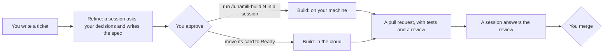

# How it works

For someone deciding whether to try Lunamill. At the end you know what
it does with a ticket, which steps are yours, and what it needs from you.
Read this before installing anything.

## A ticket's path

Two steps are yours: approving a ticket, and merging its pull request. A
[session](../reference/glossary.md) of your coding agent does every step in
between. [The workflow](../workflow/README.md) follows a ticket through
each step.

## What runs where

- **On your machine,** while you watch: refining a ticket, building it
  with `/lunamill-build 12`, and answering its review. This needs only the
  `lunamill` command: no board, no secrets, and nothing to host.
- **In the cloud,** with nobody at the keyboard, once you turn it on: the
  [automated review](../features/automated-review.md),
  [the board](../features/board.md), and
  [builds in the cloud](../features/cloud-builds.md). Each is optional and
  can come later.

## What changes for you

- **You write tickets, not prompts.** A few sentences of what you want and
  why. Lunamill asks the rest.
- **Every change is built the same way.** A test first, the change, your
  own checks, a review, and a pull request that says how it was verified.
- **You are asked only what is yours to decide,** each question with a
  recommended answer, and nothing merges without you unless you said which
  files may ([Pull requests that merge themselves](../features/auto-merge.md)).
- **Work can run while you are away.** Start a build in the cloud with one
  command, or have one start whenever you move a ticket to Ready on your
  board, with no session open on your machine.
- **You can see where everything stands.** A board shows every ticket's
  state, which session has it, and what it cost.

## The tools it works through

Lunamill works through five kinds of tool: a code host for your
repository and its pull requests, a ticket system, a board, a cloud runner
for the work with nobody at the keyboard, and a coding agent. A board and a
cloud runner are optional. [Integrations](../integrations/README.md) says
which tool of each kind is supported today.

## What you need

A repository on a supported code host, cloned on your machine, with the
code host's command-line tool signed in; a supported coding agent, signed
in; and Node 22.18 or later. Your repository can be in any language.
[Integrations](../integrations/README.md) names the supported tools, and
[Install](install.md) is the next step.

## Who it is for

Someone who uses a coding agent on a repository, in any language, and
wants tickets built the same careful way every time: one person with
several repositories, or a small team.

**What it is not.** It is not a hosted service: everything runs in your
repository, your CI, and your agent's account. It does not replace reading
the pull request.

Next: [Install](install.md).
