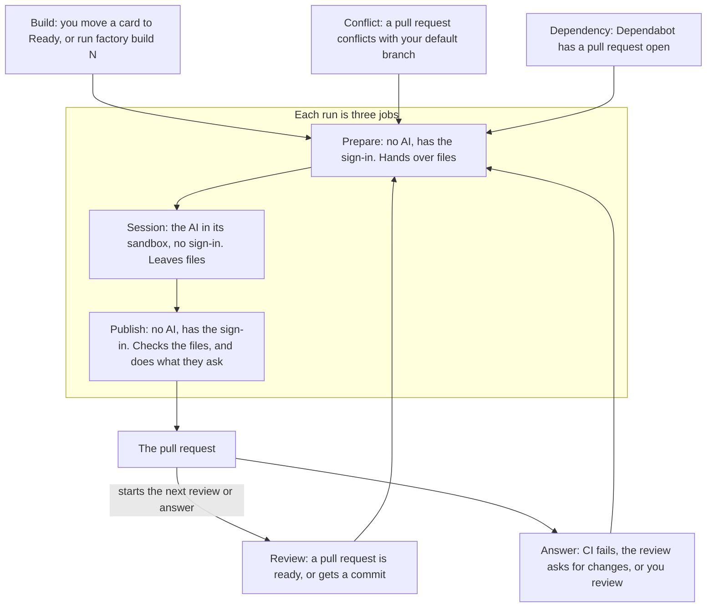

# How a cloud run is contained

For whoever judges whether a run in the cloud is safe. At the end you
know what each of a run's jobs holds, and why the session holds no
sign-in.

## What a cloud run is

Five kinds of run use your coding agent. Each is three jobs, each on a
machine of its own, so that the agent and a sign-in to your code host are
never on the same one:



| Job     | What it does                                                                                                                                        |
| ------- | --------------------------------------------------------------------------------------------------------------------------------------------------- |
| Prepare | Decides whether there is anything to do, claims the ticket of a build, and hands over the code, the ticket, and what the session may read, as files |
| Session | Runs the skill on those files, in the coding agent's sandbox. Its commands reach the npm registry, the hosts you list, and nothing else             |
| Publish | Checks the commits and the requests the session left, then pushes, opens the pull request, replies, and comments. It runs nothing the session wrote |

[What each job holds](#what-each-job-holds) says which secrets
reach which job, and
[what a hijacked session could still do](risks.md#what-a-hijacked-session-could-still-do)
says what is left.

| Run        | What starts it                                                                                                                                            | What its session does                                                                        |
| ---------- | --------------------------------------------------------------------------------------------------------------------------------------------------------- | -------------------------------------------------------------------------------------------- |
| Build      | The [poller](../features/builds-from-the-board.md#the-poller), or `factory build N`                                                                       | Builds a ticket with `factory-build`                                                         |
| Review     | A pull request marked ready, each push to it after, and a change of its base branch, with [`pr-review`](../reference/settings/pr-review.md#pr-review) on  | Reads the pull request, and answers with findings and a verdict. Publish posts them          |
| Answer     | CI failing, or the review asking for changes, on a pull request a build in the cloud opened. A review you submit, on any pull request from the repository | Works what is open with `factory-address-review`                                             |
| Conflict   | A push to your default branch, and nightly, once for each pull request that conflicts                                                                     | Merges your default branch into it, with `factory-resolve-conflicts`                         |
| Dependency | Three times a day, once for each pull request Dependabot has open                                                                                         | Moves it toward merged, with `factory-deps`, in a repository with a `.github/dependabot.yml` |

Every run but a review acts as the account a build does. A review posts
as `github-actions`.

**A run remembers nothing.** The ticket, the pull request, and its threads
are its memory. On your machine, a session
waits for CI and the review. In the cloud it ends, and says:

```text
This run ends here. The next one starts when CI and the review have finished.
```

**What a session asks for is done after it ends.** In the cloud, a `factory`
command that would write prints `Asked:` and is kept. Publish runs only a
short list of them, and only on the run's own ticket and pull request:

- Comment on the ticket or the pull request, edit the ticket, and stop or
  end the work on it.
- Open one draft pull request, from a build. It and the commits may
  say they close only the run's own ticket. For a ticket that names several
  repositories, neither may say it closes the ticket, which closes itself
  when the last one merges.
- Reply to and resolve the pull request's review threads, and ask for its
  review again.
- List a [follow-up](../workflow/follow-ups.md) in the pull request, its box
  empty, from a build or an answer.
- From a Conflict or a Dependency run, open a ticket.

Anything else, such as a label or a merge, is refused as the session asks for
it, with the reason. A `factory` command that reads something Prepare did not hand over says so:

```text
✗ Ticket 40 was not handed to this run. Go on without it, or stop with: factory ticket stop 12 "needs ticket 40"
```

**After it pushes, Publish waits for CI,** for up to an hour, and says on
the pull request when CI has not finished by then. When CI passes, it marks
a draft ready, which starts the review, unless the session opened it with
`factory pr open --draft` for you to mark ready yourself, or no build in the
cloud opened it. When CI fails, or the review asks
for changes, the next answer starts by itself, if a build in the cloud
opened the pull request. Two reviews that asked for changes are answered
([`rules.review-rounds`](../reference/settings/rules.md#rules)), and a pull request gets at most four answers started this way. Then Publish
says so on it:

```text
This waits for a person: it has had 4 answers. What is still open is in its checks and threads.
```

An answer to a review you submit counts toward neither limit. On a pull
request that no build in the cloud opened, the session that opened it
answers the automated review, or you
[start an answer by hand](../integrations/github-actions.md#the-jobs).

A session that ends early pushes nothing, and Publish says so on the ticket
or the pull request, with the run's address:

```text
The session did not finish, and nothing of its was pushed. Its run: https://your-code-host/your-name/your-repo/runs/123456789
```

## What each job holds

Each run that uses your coding agent is
[three jobs](#what-a-cloud-run-is), each on a machine of its own,
in an organization and on your own account alike:

| Job     | Is there AI in it?                   | What it holds                                                                                                                                                           |
| ------- | ------------------------------------ | ----------------------------------------------------------------------------------------------------------------------------------------------------------------------- |
| Prepare | No                                   | The App's key, or your build token                                                                                                                                      |
| Session | Yes, confined to the agent's sandbox | What pays for the session, which is kept from every command it runs, and the repository's own secrets, such as the one your `.npmrc` reads, which its commands can read |
| Publish | No                                   | The App's key, or your build token. In a review's run it also has the workflow's own token, which posts the threads and the verdict                                     |

No key or token of yours for GitHub reaches the session's job. GitHub gives
every job a workflow token of its own: this job's can only read packages,
and reaches one step, which installs your default branch's dependencies
before the session starts. Prepare and
Publish run nothing from the branch the session works on.

The App's key also reaches the jobs that run no session: the verdict, for a
pull request that is part of a ticket, telling the other repositories, who
merges, the board sync, the poller, requiring the verdict, finding the conflicts and
Dependabot's pull requests, Dependabot's auto-merge, and the updates. Each
makes a token that lasts an hour, for the run's repository and the
organization's [preset](../customize/presets.md) repositories it follows. For a ticket
that names [other repositories](../workflow/across-repositories.md), a job also makes one
for each of them alone, which can read its code and pull requests, write its
tickets, and start its runs, and can't push to it. The verdict's and the
board sync's can only read. The one
exception is the organization's poller, whose token reaches every
repository the App is installed on, since it starts builds in each.
`factory-review.yml`, the one workflow file that GitHub runs from a pull
request's own copy on every push, is given no secret.

Publish holds the key for as long as it runs, because waiting for CI can
outlast a token, and it then signs in again.
