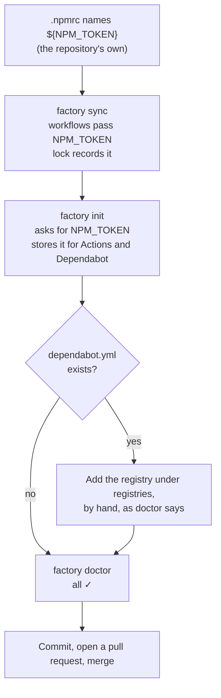
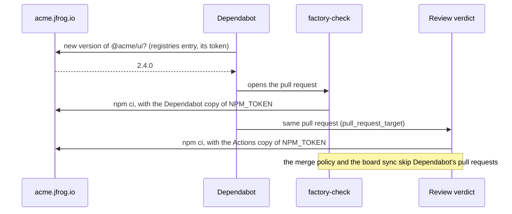

# Proposal

From [davidbyoung/software-factory#31](https://github.com/davidbyoung/software-factory/issues/31).

## Why

Every factory workflow runs `npm ci`, and none of them can authenticate to a registry: the board sync, the review verdict, the merge policy, the poller, the factory check, the automated review, and builds, through the `factory-agent` action. So a repository with any private npm dependency has every factory workflow fail at install. That dependency could be the company's own packages, or a private preset (#29).

npm has one standard for a private registry, whichever registry it is. The repository commits an `.npmrc` that maps a scope to the registry and reads the token from an environment variable:

```ini
@acme:registry=https://acme.jfrog.io/artifactory/api/npm/npm/
//acme.jfrog.io/artifactory/api/npm/npm/:_authToken=${NPM_TOKEN}
```

The factory follows that file, and never needs to know which registry it names.

## What Changes

- `factory sync` reads each environment variable that a sign-in line of the `.npmrc` at the repository's root names as `${NAME}`: a line whose key ends in `:_authToken`, `:_auth`, `:_password`, or `:username`. It writes each factory workflow that installs packages to set that variable from a secret of the same name.
- Editing `.npmrc` so the variables it names change makes the factory's settings stale, as an edit to `.claude/factory.yaml` does: `factory sync --check` fails, and commands say to run `factory sync`.
- `factory init` asks for each of those secrets that isn't set, as it does for its other secrets, and saves it twice: as an Actions secret and as a Dependabot secret.
- `factory doctor` reports, for each variable, whether its Actions secret and its Dependabot secret are set. When `.github/dependabot.yml` exists, it also reports whether that file has a `registries` entry for each registry address in `.npmrc`. Without one, Dependabot never sees a new version of a private package.
- A repository with no `.npmrc`, or one that names no variable, gets the same workflows as today.
- The setup docs say how to set up a private registry and what `factory doctor` checks for it.

## Decisions

### The owner's

Settled by the owner in session, 2026-11-19.

- **No registry gets a path of its own,** GitHub Packages included. Each one's `.npmrc` works the same way, and private registries vary from company to company.
- **The factory follows the variable names in `.npmrc`,** not one fixed secret name. A repository that already has an `NPM_TOKEN` secret for its own CI reuses it. One fixed `FACTORY_NPM_TOKEN`, passed to npm as `NODE_AUTH_TOKEN`, was turned down: a repository that uses another name would have to rename its secret or save a duplicate.
- **Each secret is saved twice,** since a workflow that a Dependabot pull request starts can read only Dependabot secrets. The factory check, which every pull request must pass, is one; the factory's other workflows that install either skip Dependabot's pull requests or run on `pull_request_target` or `workflow_run`, which read Actions secrets.
- **`.github/dependabot.yml` stays the repository's own.** `factory doctor` checks its registry entries, and nothing writes them.
- **This is separate from #29.** Any private dependency needs it, and presets on a public registry work without it. A private preset needs this ticket built first.
- It changes every factory workflow, so the pull request gets a `factory-trace`. It changes what a factory user sees, so it is a candidate for the docs-first pass in #30 before refinement.

Settled by the owner in session, 2026-11-19.

- **No registry gets a path of its own,** GitHub Packages included. Each one's `.npmrc` works the same way, and private registries vary from company to company.
- **The factory follows the variable names in `.npmrc`,** not one fixed secret name. A repository that already has an `NPM_TOKEN` secret for its own CI reuses it. One fixed `FACTORY_NPM_TOKEN`, passed to npm as `NODE_AUTH_TOKEN`, was turned down: a repository that uses another name would have to rename its secret or save a duplicate.
- **Each secret is saved twice,** since a workflow that a Dependabot pull request starts can read only Dependabot secrets. The factory check, which every pull request must pass, is one; the factory's other workflows that install either skip Dependabot's pull requests or run on `pull_request_target` or `workflow_run`, which read Actions secrets.
- **`.github/dependabot.yml` stays the repository's own.** `factory doctor` checks its registry entries, and nothing writes them.
- **This is separate from #29.** Any private dependency needs it, and presets on a public registry work without it. A private preset needs this ticket built first.
- It changes every factory workflow, so the pull request gets a `factory-trace`. It changes what a factory user sees, so it is a candidate for the docs-first pass in #30 before refinement.

### Not doing

- Registries whose tokens expire within hours, such as AWS CodeArtifact, which need a login command before `npm ci` rather than a stored secret. A setting for a command to run before installing can come when someone needs it.
- An `.npmrc` anywhere but the repository's root.

## Proposed docs

What a developer types and sees, agreed with the owner in session on 2026-11-20. The owner accepted the three questions' recommendations as written.

### The problem

The reader is a developer whose repository installs something private:
their company's own packages, or a private preset. On their machine it
works, because their shell has the token. In GitHub Actions, every
factory workflow fails at its first step that matters, `npm ci`, with
npm's 401, because nothing passes the token in: the factory check on
every pull request, the review verdict, the board sync, the poller, and
every cloud build and review. And Dependabot never offers them a new
version of a private package, because it has not been told the
registry.

### What they already have

Nothing new to write. The repository's own `.npmrc`, committed, the way
npm documents it for any private registry:

```ini
# .npmrc
@acme:registry=https://acme.jfrog.io/artifactory/api/npm/npm/
//acme.jfrog.io/artifactory/api/npm/npm/:_authToken=${NPM_TOKEN}
```

The factory reads one thing from it: the `${NAME}` in each line that
signs in, which is a line whose key ends in `:_authToken`, `:_auth`,
`:_password`, or `:username`. Here, `NPM_TOKEN`. It reads the variable
as npm does: `${NAME?}` counts, and `\${NAME}` is text, not a variable.
A `${...}` anywhere else, such as `cache=${HOME}/.npm-cache`, is the
developer's own, and the factory leaves it alone.

### 1. `factory sync`

They run it as they do after any settings change. The output is what it
is today, a line per file it wrote:

```text
$ factory sync
wrote .github/workflows/factory-check.yml
wrote .github/workflows/factory-board-sync.yml
wrote .github/workflows/factory-review-verdict.yml
wrote .github/workflows/factory-build.yml
wrote .github/workflows/factory-review.yml
wrote .claude/factory.lock
```

Each job that installs packages now has the variable, from a secret of
the same name, in its `env`, so every step that runs npm or `npx` has it
(changed in refinement from the install step alone, since setting up Node
and every later `npx` step read `.npmrc` too):

```diff
   check:
     runs-on: ubuntu-latest
+    env:
+      NPM_TOKEN: ${{ secrets.NPM_TOKEN }}
```

> **Settled 1: as recommended.**
>
> **Question 1. Do cloud sessions get the token too?** The builds, the
> review, the conflict sweep, and the dependency session install through
> the `factory-agent` step, and the session that follows may install
> again: a build that adds a private dependency runs `npm install`, and
> the dependency session rebuilds the lockfile.
>
> **Recommended: yes.** In those four workflows the job's `env` holds
> it, as above, so both the action's install and the session see it. The
> alternative, keeping it from the session, means a build that adds a
> private package then fails at its gate.
>
> A session reads ticket and review text that anyone with access can
> write, so the token it holds should be worth little: the docs page says
> to make it read-only, and limited to the packages the repository
> installs. The session already holds a GitHub token that can push, so
> this adds less than it sounds.

The lock records the names it read, so a review of the sync's pull
request shows them, and so a later change to them is caught:

```yaml
# .claude/factory.lock
version: 0.5.0
presets: []
settings-hash: 3f9a…
npmrc-variables:
  - NPM_TOKEN
settings: ...
```

A repository with no `.npmrc`, or one whose token lines name no
variable, gets `npmrc-variables: []` and the same workflows as today.

#### When `.npmrc` changes

Adding, removing, or renaming the variable in a token line stops the
factory's commands as an edit to `.claude/factory.yaml` does:

```text
$ factory status
.npmrc changed since the last sync. Run: npx --no-install factory sync
```

```text
$ factory sync --check
.npmrc changed since the last sync. Run: npx --no-install factory sync
```

Any other edit, such as a new registry address or a new `cache=` line,
changes nothing the factory writes, so nothing stops. `factory doctor`
still checks each registry address against Dependabot's settings
(section 3).

#### A name the runner already uses

A token line that reads a variable GitHub's runner sets for itself, such
as `HOME`, `PATH`, `CI`, or one starting with `RUNNER_`, `ACTIONS_`, or
`GITHUB_` (other than `GITHUB_TOKEN`, below), stops the sync, since
setting it from a secret would break the job:

```text
$ factory sync
.npmrc reads ${GITHUB_PACKAGES_TOKEN} to sign in, and GitHub refuses a secret whose name starts with GITHUB_. Rename it in .npmrc, then run: npx --no-install factory sync
```

```text
$ factory sync
.npmrc reads ${HOME} to sign in, and the runner sets HOME for itself. Rename it in .npmrc, then run: npx --no-install factory sync
```

> **Settled 2: as recommended.**
>
> **Question 2. A `${GITHUB_TOKEN}`, the usual line for GitHub Packages.**
> GitHub refuses a secret by that name, so `init` could never store it,
> and every workflow already has a token by that name. But each factory
> workflow lists its own permissions, and none lists `packages`, so that
> token cannot read a package today.
>
> **Recommended:** sync passes the workflow's own token,
> `GITHUB_TOKEN: ${{ secrets.GITHUB_TOKEN }}`, and adds `packages: read`
> to the permissions of each workflow it passes it to:
>
> ```diff
>  permissions:
>    contents: read
> +  packages: read
> ```
>
> `init` asks nothing for it, and `doctor` says what that token can read:
>
> ```text
> - GITHUB_TOKEN is the workflow's own token: it installs only the packages that give this repository access
> ```
>
> **Adds a Decision** beside "No registry gets a path of its own": this is
> a rule about GitHub's secret names and token permissions, not about the
> registry.

### 2. `factory init`

`init` shows the variables in what it found, asks for each secret that is
not set, and stores it twice. Shown for a repository where the factory is
already set up and `.npmrc` has just gained its token line:

```text
$ factory init
Setting up the software factory for acme/billing

Found
  Code host      GitHub (from your git remote)
  Tickets        GitHub Issues
  Coding agent   Claude Code
  Cloud builds   GitHub Actions
  package.json   yes
  .npmrc         reads NPM_TOKEN
  Settings       .claude/factory.yaml
  Board          7, from your settings

✔ Which parts do you want? (already chosen)

This is everything setup will do:
  Write    .github/workflows/factory-check.yml
  Write    .github/workflows/factory-build.yml
  Write    .claude/factory.lock
  Secrets  NPM_TOKEN for Actions and for Dependabot
✔ Go ahead? Yes

.npmrc reads NPM_TOKEN for https://acme.jfrog.io/artifactory/api/npm/npm/.
The factory's workflows install with it. Use a token that can only read.
✔ Paste it (leave empty to do this later): ••••••••
Stored NPM_TOKEN for Actions and for Dependabot.

Nothing is committed. Left to do:
  1. Commit this on a branch, open a pull request, and merge it.
```

**Why twice.** A workflow that a Dependabot pull request starts through
`pull_request` reads only Dependabot secrets. Of the factory's workflows
that install, that is `factory-check`, which every pull request must
pass; the rest either skip Dependabot's pull requests or run on
`pull_request_target` or `workflow_run`, which read the Actions copy.
Without the Dependabot copy, every Dependabot pull request fails its
check. **Changes a Decision:** "Each secret is saved twice" keeps its
choice, with this as its reason in place of "the workflow that syncs an
update's pull request".

The address it names is the `registry=` URL in `.npmrc` whose host and
path the token line starts with, or, with none, the token line's own host
and path.

Where the repository already has an `NPM_TOKEN` Actions secret, for its
own CI, but no Dependabot one, `init` asks only for that copy. GitHub
never shows a stored value, so it cannot copy it across:

```text
NPM_TOKEN is set for Actions but not for Dependabot, and GitHub never shows a secret's value.
✔ Paste the same token again (leave empty to do this later): ••••••••
Stored NPM_TOKEN for Dependabot.
```

Left empty:

```text
No NPM_TOKEN stored. The factory's workflows fail at npm ci until it is. Run npx --no-install factory init again to add it.
```

Where both copies are set, `init` asks nothing new: the existing "N
secrets these parts read are already set. Replace them?" now counts them.

> **Settled 3: as recommended.**
>
> **Question 3. A secret the organization sets.** A company with many
> repositories usually sets `NPM_TOKEN` once, as an organization secret
> shared with each repository. Today `init` and `doctor` look only at the
> repository's own secrets, for every secret the factory reads, so they
> would ask for it again and report it missing.
>
> **Recommended:** count an organization secret shared with the
> repository as set, for every secret the factory reads, not only these.
> GitHub lists the organization's Actions secrets to anyone who can see
> the repository's, but lists its Dependabot secrets only to an
> organization admin. When `doctor` cannot see them, it says it cannot
> tell, rather than that the secret is missing:
>
> ```text
> ✓ NPM_TOKEN is set by the organization, for installing what .npmrc names
> ? NPM_TOKEN is not set for Dependabot on the repository, and only an organization admin can see whether the organization sets it
> ```
>
> A repository a person owns, not an organization, has no organization
> secrets, so a missing one there is a plain ✗.
>
> `init` still asks for a Dependabot copy it cannot see, and says why, so
> a developer whose organization sets it leaves the prompt empty (settled
> in refinement, 2026-11-20):
>
> ```text
> NPM_TOKEN isn't set for Dependabot on this repository, and only an organization admin can see whether your organization sets it. If it does, leave this empty.
> ✔ Paste it (leave empty to do this later):
> ```
>
> It does not set organization secrets itself; the docs page gives an
> admin the two commands. The `?` is a new kind of line, which fails nothing. **Adds a
> Decision.**

### 3. `factory doctor`

Three new kinds of line, after the secrets the parts read:

```text
$ factory doctor
✓ The settings are valid
✓ The factory's files match the settings
✓ Version 0.5.0 is installed, as the repository records
✓ Signed in to the code host as dana
✓ CLAUDE_CODE_OAUTH_TOKEN is set, for an automated review of every pull request
✓ NPM_TOKEN is set, for installing what .npmrc names
✓ NPM_TOKEN is set for Dependabot, for installing on Dependabot's pull requests
✓ .github/dependabot.yml uses https://acme.jfrog.io/artifactory/api/npm/npm/ for its npm updates
...
```

When something is missing, each line says what to do:

```text
✗ NPM_TOKEN is not set, for installing what .npmrc names. Run npx --no-install factory init
✗ NPM_TOKEN is not set for Dependabot, for installing on Dependabot's pull requests. Run npx --no-install factory init
? .github/dependabot.yml doesn't use https://acme.jfrog.io/artifactory/api/npm/npm/ for its npm updates: unless your organization sets that registry for Dependabot, it never sees a new version of a package from there. Add it under registries, and name it in the npm entry's registries
```

The registry line is checked for each registry address `.npmrc` names,
by a `@scope:registry=` line or a plain `registry=` line, and only when
`.github/dependabot.yml` exists. "Uses" means both halves Dependabot
needs: an entry under the top-level `registries` with that `url`, and its
name listed under the npm update's own `registries` (or
`registries: "*"`). A missing one is a `?`, not a ✗: GitHub lets an
organization set private registries for Dependabot in every repository,
which the repository cannot see. With no `dependabot.yml`, there is no
line.

### Workflows

#### Setting it up



#### A private package's new version



#### The token expires

The first workflow after it fails at `npm ci` with npm's own 401. The
fix is both copies, by `factory init` (answering yes to replace) or
directly:

```bash
gh secret set NPM_TOKEN
gh secret set NPM_TOKEN --app dependabot
```

An organization that sets it centrally replaces its own two instead,
with `--org`.

### Not doing

From the ticket: registries whose tokens last hours (AWS CodeArtifact),
and an `.npmrc` anywhere but the root. Also, in this draft:

- **No sign-in without a stored token** (OIDC), which JFrog, Azure, and
  others offer. Each needs a login step of its own registry's, so it
  belongs with the ticket's deferred "command to run before installing".
- **No setting to keep the token from cloud sessions** (question 1),
  until someone asks for one.
- **No check that a pasted token works.** The factory would need to know
  a package to fetch from that registry. A wrong token shows at the first
  workflow, as npm's 401.
- **No line for an `.npmrc` that names a registry but no token**, which
  works on a machine whose own `~/.npmrc` has the token and fails in every
  workflow. A public mirror looks the same, so `doctor` cannot tell them
  apart. The docs page says the token line is needed.
- **`init` sets no organization secret.** The docs page gives the
  commands.
- **A pull request from a fork** cannot install a private package: GitHub
  gives it no secrets. The docs page's limits say so.

### For the build to confirm

Facts no GitHub document states, each settled by one test run, and
the design changes only if one is false:

- A run that a Dependabot pull request starts, whose own token is
  read-only, can still be given `packages: read` (question 2).
- On a public repository, `cache: npm` does not hand a fork's pull request
  the private packages the default branch cached.

### The docs page: a new section of `docs/github/setup.md`, before "Doing it by hand"

#### Private npm packages

For a repository that installs a package from a private registry, such as
your company's own packages or a private [preset](../presets.md). At the
end, the factory's workflows install it as your machine does, and
Dependabot offers its new versions.

##### 1. Read the token from a variable in `.npmrc`

The workflows sign in to your registry the way npm does on your machine:
from the `.npmrc` at the root of your repository, which you commit. It
needs two lines, one that sends your packages' scope to the registry and
one that reads the token from an environment variable:

```ini
@acme:registry=https://acme.jfrog.io/artifactory/api/npm/npm/
//acme.jfrog.io/artifactory/api/npm/npm/:_authToken=${NPM_TOKEN}
```

Your registry's documentation gives both lines with its own address. The
variable can have any name; the factory stores the token as a secret of
the same name, so wherever this section says `NPM_TOKEN`, use yours. On
your machine, set the variable in your shell's profile, such as
`export NPM_TOKEN=...`. If the token line is only in your own
`~/.npmrc`, move it into this file with the variable in place of the
token: the workflows read only this one.

**It worked when** `npm ci` succeeds on your machine with the variable
set.

###### GitHub Packages

Read `${GITHUB_TOKEN}` in the token line. In the workflows it is their own
token, which can read the packages that give this repository access, so
`init` asks for nothing and you skip step 2. On your machine, set
`GITHUB_TOKEN` to a personal access token with the `read:packages` scope.
Dependabot has no token of its own for it: in step 4, store that personal
access token with `gh secret set PACKAGES_TOKEN --app dependabot`, and
name `PACKAGES_TOKEN` in place of `NPM_TOKEN`.

##### 2. Make a read-only token

On your registry, make a token that can only read, and only the packages
this repository installs. Builds and reviews in the cloud hold it while
they work, and they read tickets and pull requests that anyone with access
to the repository can write, so a read-only token is all that text could
ever lead one to give away.

##### 3. Store it with `factory init`

```bash
factory init
```

Under "Found", `init` lists `.npmrc` and the variable it reads. Then it
asks you to paste the token, rewrites the factory's workflows under
`.github/workflows/` to pass the token to npm, and stores it twice: as an
Actions secret, and as a Dependabot secret, since a workflow that
Dependabot's pull request starts can read only Dependabot secrets. If
`.npmrc` isn't listed under "Found", the token line is missing from the
file at your repository's root.

If your organization already shares the secret with this repository,
`init` does not ask for the Actions copy. It still asks for the Dependabot
copy, since only an organization admin can see whether the organization
sets that one: leave it empty if yours does. To set both once for every
repository, an organization admin runs:

```bash
gh secret set NPM_TOKEN --org acme --visibility all
gh secret set NPM_TOKEN --org acme --visibility all --app dependabot
```

##### 4. Tell Dependabot the registry

Skip this without a `.github/dependabot.yml`, or when your organization
sets the registry for Dependabot, which an organization admin can tell
you. Otherwise add the registry, and name it in your npm entry, or
Dependabot never sees a new version of a package from there:

```yaml
registries:
  acme: # any name; the npm entry uses it
    type: npm-registry
    url: https://acme.jfrog.io/artifactory/api/npm/npm/ # as in .npmrc
    token: ${{secrets.NPM_TOKEN}} # the Dependabot secret from step 3
updates:
  - package-ecosystem: npm
    directory: /
    registries: [acme]
    schedule:
      interval: weekly
```

##### 5. Check it, and merge

Run `factory doctor`. **It worked when** it shows:

```text
✓ NPM_TOKEN is set, for installing what .npmrc names
✓ NPM_TOKEN is set for Dependabot, for installing on Dependabot's pull requests
✓ .github/dependabot.yml uses https://acme.jfrog.io/artifactory/api/npm/npm/ for its npm updates
```

Without a `.github/dependabot.yml` there is no third line. A line that
starts with `?` is one `doctor` cannot check from the repository, such as
a secret or a registry your organization may set, which only an
organization admin can see. It fails nothing.

Then commit `.npmrc` and what `init` wrote on a branch, open a pull
request, and merge it as any other change. The pull request's own
"Factory check" is the last check: its "Install dependencies" step passes
once the workflows can sign in.

##### Replacing the token

When the token expires, the next workflow fails at `npm ci` with a 401.
Store the new one in both places:

```bash
gh secret set NPM_TOKEN
gh secret set NPM_TOKEN --app dependabot
```

or run `factory init` and answer yes when it asks to replace the secrets
already set. An organization admin runs the two commands in step 3
again instead.

If you rename the variable in `.npmrc`, the factory's commands stop and
say to run `factory sync`, which rewrites the workflows for the new name.

### Other pages that change

#### `docs/presets.md`, "Private presets"

The _Planned_ paragraph goes, and the section points at the new one:

```diff
 A preset is an npm package, so a private one installs on your machine the
 way any other private package does, from whichever registry your company
-uses, through your repository's `.npmrc`. Give the preset a Dependabot
-group of its own, the way
-[Dependency bots](github/reference.md#dependency-bots) does for the
-factory, and add its registry under `registries` in
-`.github/dependabot.yml`, so Dependabot sees its new versions.
-`factory preset add` names either one that's missing.
-
-_[Planned](developing.md#what-is-built)_: the factory's workflows can't
-install a private package yet, so a private preset works on your machine
-and not yet in the factory's workflows.
+uses, through your repository's `.npmrc`.
+[Private npm packages](github/setup.md#private-npm-packages) sets up the
+factory's workflows and Dependabot to install it too. Give the preset a
+Dependabot group of its own as well, the way
+[Dependency bots](github/reference.md#dependency-bots) does for the
+factory. `factory preset add` names what's missing.
```

#### `docs/limitations.md`

The bullet goes:

```diff
-- **A private [preset](presets.md) works on your machine, not yet in the
-  factory's workflows.** _[Planned](developing.md#what-is-built)_: the
-  workflows can't install a private package yet.
```

#### `docs/github/reference.md`

"What setup adds", On GitHub, a new row:

```diff
 | `CLAUDE_CODE_OAUTH_TOKEN` | You create it, for the automated review and builds in the cloud | Delete it, unless another workflow uses it |
+| The secrets your `.npmrc` reads, such as `NPM_TOKEN`, for Actions and for Dependabot | `init`, when you paste them | Leave them if your own CI uses them; otherwise delete both copies |
```

"Limits", a new bullet, since it comes from GitHub:

```diff
+- **A pull request from a fork can't install a private package.** GitHub
+  gives a fork's pull request no secrets, so the factory check fails at
+  `npm ci` on one, in a repository with
+  [private npm packages](setup.md#private-npm-packages).
```

#### `docs/github/by-hand.md`, "Secrets"

A line after the table:

```diff
+For a private npm registry, each variable your `.npmrc` reads is stored
+twice, with `gh secret set NAME` and `gh secret set NAME --app dependabot`:
+[Private npm packages](setup.md#private-npm-packages).
```

#### `docs/github/setup.md`, "Changing it later"

`doctor`'s list gains the new checks:

```diff
 runs the checks again at any time: the settings, the factory's files, the
 installed version, who the GitHub CLI is signed in as, that each secret
-your parts read is set, and the board's columns.
+your parts read is set, those for
+[private npm packages](#private-npm-packages), and the board's columns.
```

#### `docs/github/setup.md`, "Run `factory init`"

The table of what `init` asks gains a row:

```diff
+| The token your `.npmrc` reads | Nothing: it asks whenever `.npmrc` reads one ([Private npm packages](#private-npm-packages)) | Paste a token that can only read from your registry |
```

### Settled in the docs-first draft, 2026-11-20

- **Only sign-in lines count.** A `${NAME}` is taken from a line whose key ends in `:_authToken`, `:_auth`, `:_password`, or `:username`, read as npm reads it, so `cache=${HOME}/...` never becomes a secret. The Done when line now says so.
- **Cloud sessions get the token** (question 1), so the session can install too. The docs say to make the token read-only and limited to the packages installed.
- **`${GITHUB_TOKEN}` is the workflow's own token** (question 2): sync passes `secrets.GITHUB_TOKEN` and adds `packages: read` to each workflow it passes it to; `init` asks nothing for it. Any other `GITHUB_` name, or a name the runner sets for itself, stops the sync. A rule about GitHub's secret names and permissions, beside "No registry gets a path of its own".
- **Organization secrets count** (question 3), for every secret the factory reads: an Actions secret the organization shares with the repository is set. Where the organization's Dependabot secrets cannot be listed, `doctor` prints a `?` line, a new kind that fails nothing.
- **The reason for saving each secret twice** is corrected in the Decision above: only the factory check reads the Dependabot copy.
- **A registry missing from `dependabot.yml` is a `?`,** since an organization can set Dependabot's registries centrally.
- **The lock records the names** as `npmrc-variables`, so the sync's pull request shows them and a change to them makes the lock stale.

### Settled in refinement, 2026-11-20

- **`init` asks for a Dependabot copy it cannot see,** saying only an organization admin can see whether the organization sets it, and to leave the prompt empty if it does. Asking only where it is sure there is none would leave most organization repositories without the copy, failing the factory check on every Dependabot pull request.
- **`init` runs the sync itself,** so the docs page leads with `factory init` alone.
- **The fork-safety rule** (`tests/fork-safety.test.ts`) reads the workflow sources, which do not change. The synced `factory-check.yml` then reads a secret on `pull_request` with no fork guard. That is safe: GitHub gives a fork's run no secrets, so its install fails, which the reference's Limits says. A guard would skip the check on forks, and a skipped required check passes.
- **The variable goes in the job's `env`,** not on the install step: setting up Node with `cache: npm` and every later `npx --no-install factory` step read `.npmrc` too, and a job's `env` reaches the steps of a composite action, which settles the first fact the draft left for the build.
- **Sync inserts lines and changes nothing else** in a workflow, as its other edits to workflows do, so the synced file is the source plus the added lines.
- **No build order.** #33 also changes `init.mts`, which is a merge conflict, not a blocker. #29 is built.
